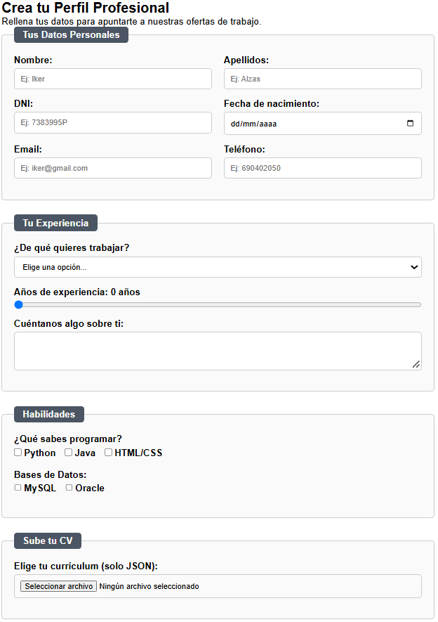
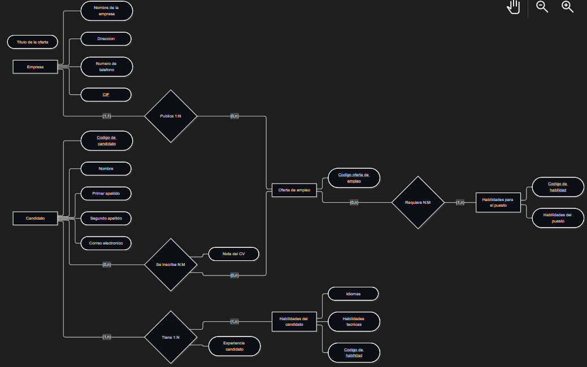

# TalentConnect - Tu Gestor de Talento Inteligente

## Equipo de Desarrollo
* Iker Calvo
* Ekhi Loidi
* Oier Yurre
* Erik Alzas

## Objetivos del Proyecto
Este proyecto se desarrolla para resolver la gestión masiva de currículums de una empresa tecnológica. El objetivo principal es ofrecer una solución digital, eficiente y sostenible que elimine el uso de papel. A través de este formulario web, la empresa puede recopilar la información personal, experiencia, habilidades técnicas y el currículum de los candidatos de forma estructurada.

## Instrucciones de Uso
1. Abre el archivo `index.html` en cualquier navegador web moderno.
2. Completa los campos obligatorios del apartado **Datos Personales** (asegúrate de incluir un `@` en el email).
3. En el apartado **Tu Experiencia**, selecciona tu puesto de interés y utiliza la barra deslizante para indicar tus años de experiencia.
4. Marca tus conocimientos en lenguajes de programación y bases de datos en la sección **Habilidades**.
5. Sube tu currículum haciendo clic en "Elige tu currículum". El sistema solo aceptará archivos con la extensión `.json`.
6. Haz clic en el botón **Enviar Datos**. Si la validación es correcta, el sistema generará un paquete de datos interno y mostrará un mensaje de confirmación en color verde.

## Interfaz y Arquitectura

*Figura 1: Interfaz de usuario del formulario de registro.*

*Figura 2: Diagrama de relaciones Entidad-Relación del sistema.*

## Tecnologías Utilizadas
* **HTML:** Estructura semántica adaptada a la empleabilidad.
* **CSS:** Diseño responsivo utilizando Flexbox y CSS Grid.
* **JavaScript:** Validación de datos en el cliente y manipulación del DOM mediante `addEventListener`.